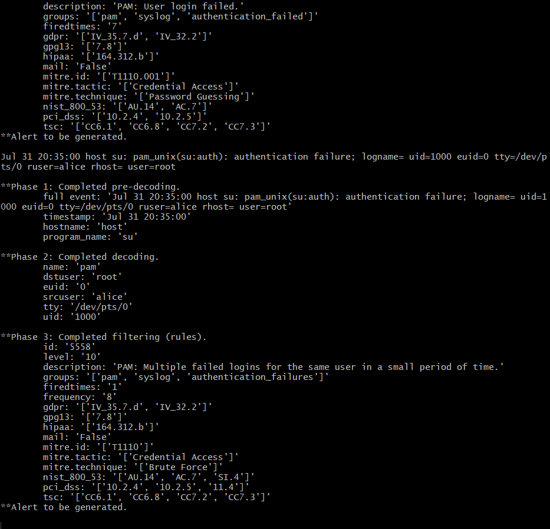

# 🔧 Wazuh PAM Frequency Fix

A security engineering case study documenting my contribution to Wazuh that addresses a detection gap in PAM authentication correlation.

The contribution introduces a new correlation rule that detects repeated local PAM authentication failures by correlating on the authenticated user when no source IP is available.

---

## 📌 Project Status

| Item               | Status                                                           |
| ------------------ | ---------------------------------------------------------------- |
| **Issue**          | [wazuh/wazuh#16252](https://github.com/wazuh/wazuh/issues/16252) |
| **Pull Request**   | [wazuh/wazuh#38270](https://github.com/wazuh/wazuh/pull/38270)   |
| **Target Branch**  | `4.14.9`                                                         |
| **Current Status** | Submitted – Awaiting maintainer review                           |

> **Note:** An earlier pull request ([#38154](https://github.com/wazuh/wazuh/pull/38154)) targeted the wrong branch and was closed after the issue was identified and corrected.

This repository documents the complete investigation, implementation, validation, and lessons learned. My development fork containing the full commit history is maintained separately.

---

# 🎯 The Problem

Wazuh rule 5551 detects repeated PAM authentication failures by correlating events using:

```xml
<same_source_ip />
```

This works well for remote authentication methods such as SSH because the PAM decoder extracts the client address from the `rhost` field.

However, local authentication methods such as:

* `su`
* `login`

do not include a remote host.

Since no source IP is extracted, the correlation condition can never be satisfied. As a result, repeated local authentication failures continue matching the base rule but never generate the higher severity frequency alert.

This creates a detection gap for repeated local authentication attempts.

---

# 💡 Solution

To address this limitation, I added a new correlation rule (5558) that correlates authentication failures using:

```xml
<same_user />
```

instead of

```xml
<same_source_ip />
```

The original rule 5551 remains unchanged.

```xml
<rule id="5558" level="10" frequency="8" timeframe="180">
    <if_matched_sid>5503</if_matched_sid>
    <same_user />
    <description>PAM: Multiple failed logins for the same user in a small period of time.</description>

    <mitre>
        <id>T1110</id>
    </mitre>

    <group>
        authentication_failures,
        pci_dss_10.2.4,
        pci_dss_10.2.5,
        pci_dss_11.4,
        gpg13_7.8,
        gdpr_IV_35.7.d,
        gdpr_IV_32.2,
        hipaa_164.312.b,
        nist_800_53_AU.14,
        nist_800_53_AC.7,
        nist_800_53_SI.4,
        tsc_CC6.1,
        tsc_CC6.8,
        tsc_CC7.2,
        tsc_CC7.3
    </group>
</rule>
```

---

# 📋 Rule Summary

| Property     | Value                              |
| ------------ | ---------------------------------- |
| Rule ID      | **5558**                           |
| Parent Rule  | 5503                               |
| Correlation  | `same_user`                        |
| Frequency    | 8 events                           |
| Timeframe    | 180 seconds                        |
| Alert Level  | 10                                 |
| MITRE ATT&CK | T1110 : Brute Force                |
| Change Type  | Additive (existing rule unchanged) |

---

# 🔄 Detection Flow

```text
PAM Authentication Failure
          │
          ▼
      Rule 5503
          │
          ▼
 Is source IP available?
      ┌───────────────┐
      │               │
     Yes             No
      │               │
      ▼               ▼
 Rule 5551       Rule 5558
same_source_ip   same_user
      │               │
      └───────┬───────┘
              ▼
     Repeated Failures
              │
              ▼
            Alert
```

---

# ✅ Validation

Before submission, the rule was validated through both static verification and runtime testing.

### Static Validation

| Check              | Result                   |
| ------------------ | ------------------------ |
| XML parsing        | ✅ Pass                   |
| Rule ID uniqueness | ✅ Pass                   |
| `git diff --check` | ✅ Pass                   |
| Final diff scope   | One file, 11 lines added |

### Runtime Validation

Validation was performed using:

* `wazuh/wazuh-manager:4.14.6`
* Modified rules copied into the container
* `wazuh-logtest`

Seven repeated local PAM authentication failures matched only Rule 5503.

The eighth event within the configured 180-second timeframe successfully triggered Rule 5558 with:

* Alert Level 10
* MITRE Technique T1110



Additional screenshots and notes are available in the evidence directory.

---

# 🔍 Challenges Encountered

During development I initially opened a pull request against the **main** branch.

While reviewing the changes, a rebase revealed that the legacy XML ruleset directory no longer existed on `main` because of ongoing upstream refactoring. The change therefore belonged on the maintenance branch instead.

To correct this I:

* rebased onto `4.14.9`
* removed an accidentally duplicated rule introduced during an earlier patch application
* reopened the contribution against the correct branch
* closed the original pull request with an explanation to avoid duplicate submissions

The complete timeline is documented in the accompanying report.

---

# 📂 Files Modified

| Item                    | Value                              |
| ----------------------- | ---------------------------------- |
| File                    | `ruleset/rules/0085-pam_rules.xml` |
| New Rule                | 5558                               |
| Existing Rules Modified | None                               |
| Lines Added             | 11                                 |

---

# 📄 Technical Report

The complete engineering report is available here:

**📄 [Wazuh PAM Frequency Fix Report (PDF)](./report/Wazuh_PAM_Frequency_Fix_Report.pdf)**

It documents:

* Root cause investigation
* Decoder analysis
* Development workflow
* Validation process
* Testing methodology
* Pull request history
* Lessons learned

---

# 🔗 References

* **Issue:** https://github.com/wazuh/wazuh/issues/16252
* **Pull Request (Closed for further improvement):** https://github.com/wazuh/wazuh/pull/38270
* **Closed Pull Request:** https://github.com/wazuh/wazuh/pull/38154

---
